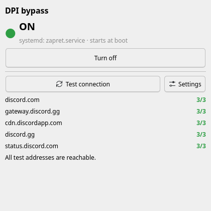

# DPI Dashboard

[Türkçe](README.tr.md)

A small desktop window to **turn a DPI-bypass service on and off** and **check whether it
actually works** — without touching a terminal.



Some internet providers block sites with deep packet inspection (DPI): the connection is
cut in the middle of the TLS handshake as soon as the site name is seen. Tools like
[zapret](https://github.com/bol-van/zapret) and [GoodbyeDPI](https://github.com/ValdikSS/GoodbyeDPI)
get around this, but they run as system services that you normally start and stop from
the command line. DPI Dashboard is a front end for that service.

> **DPI Dashboard does not bypass anything by itself.** It controls a bypass service.
> If you do not have one yet, the **Setup** button can install
> [zapret](https://github.com/bol-van/zapret) for you, see [Setup](#setup).

## Features

- One button to turn the service on or off. It also sets whether it starts at boot.
- Live status: on/off and whether it starts at boot.
- Connection test against a list of sites (Discord by default), several attempts each.
  It tells *how* a failed attempt failed: connection reset (the usual DPI signature),
  timeout, DNS failure, or a rejected certificate.
- Asks for the administrator password each time (polkit on Linux, UAC on Windows).
  No permanent "passwordless" rule is installed.
- **Setup** for a computer that has nothing yet: finds what is missing, downloads and
  verifies zapret, installs it as a service and picks a setting that works on your
  connection. **Remove** undoes it.
- English and Turkish, picked from the system language.
- Linux (systemd) and Windows.

## Requirements

| | Linux | Windows 10 / 11 |
|---|---|---|
| Bypass service | `zapret.service` from [zapret](https://github.com/bol-van/zapret) (`install_easy.sh`, or the AUR `zapret` / `zapret-git` packages) | A Windows service named `zapret` (e.g. the `service.bat` of [zapret-discord-youtube](https://github.com/Flowseal/zapret-discord-youtube)) or `GoodbyeDPI` (the `service_install_*.cmd` scripts of GoodbyeDPI) |
| Service manager | systemd | Windows services |
| Password prompt | polkit with an authentication agent (KDE and GNOME have one) | UAC |
| Python (only when not using the `.exe`) | 3.10+ with PyQt6 | 3.10+ with PyQt6 |

If you have none of these, use [Setup](#setup). If your service has a different name, set
it in the [settings file](#settings).

Not supported: Linux systems without systemd (OpenRC, runit, s6), macOS, Windows on ARM.

## Install

### Linux

```bash
git clone https://github.com/hamer1818/dpi-dashboard.git
cd dpi-dashboard
./scripts/install-linux.sh
```

Then search for **DPI Dashboard** in your application menu (`dpi`, `zapret` and
`discord` also find it). Everything goes into your home directory; no root is needed.
If PyQt6 is already installed from your distribution (`python-pyqt6`, `python3-pyqt6`),
it is reused. To remove it: `./scripts/uninstall-linux.sh`.

Debian/Ubuntu may need `sudo apt install python3-venv` first.

### Windows

Download `dpi-dashboard-<version>-windows-x64.exe` from
[Releases](https://github.com/hamer1818/dpi-dashboard/releases) and run it. No install
step.

The file is not code-signed, so SmartScreen may warn about an unknown publisher:
choose **More info → Run anyway**. You can also build it yourself, see
[Development](#development).

### With pip

```bash
pip install git+https://github.com/hamer1818/dpi-dashboard.git
dpi-dashboard
```

This does not add a menu entry on Linux; use the install script for that.

## Setup

**Setup** checks the computer and shows what it found: whether the service and the zapret
files are there, which tools are missing, and whether DNS answers look forged. Then it
offers one of:

- **Install zapret and find a working setting** (nothing installed yet), or
- **Find the best setting again** (zapret is installed, e.g. after your provider changed
  how it blocks).

Installing does this, asking for the administrator password once:

1. Downloads the latest release from
   [github.com/bol-van/zapret](https://github.com/bol-van/zapret/releases). The archive
   must match the SHA-256 checksum published by GitHub, and every program inside it must
   match upstream's own `sha256sum.txt`. Otherwise nothing is installed.
2. Linux: copies it to `/opt/zapret`, links the programs for your processor
   (`install_bin.sh`), writes the config and the `zapret.service` unit. Missing `curl` or
   `nftables` are installed with your package manager (pacman, apt, dnf, zypper).
   Windows: copies `winws` and WinDivert to `%ProgramFiles%\zapret` and creates the
   `zapret` service.
3. Measures the sites from your settings with zapret off, then tries the strategies one
   by one and keeps the first that reaches all of them (or the best one). If none helps,
   the previous settings are restored.
4. Turns the service on and sets it to start at boot.

**Remove** stops and deletes the service and the files. It only removes what DPI
Dashboard installed: a zapret from a distribution package or another installer is
never deleted. On Windows, a service installed by another tool is only turned on and
off, never reconfigured.

On Linux with systemd-resolved, setup can also turn on encrypted DNS (DNS-over-TLS) when
DNS answers look forged. On Windows it shows how to turn on DNS over HTTPS instead.

The strategies tried, in order, are listed in
[`setup/strategies.py`](src/dpi_dashboard/setup/strategies.py); put your own in the
`strategies` setting. The same steps can be run from a terminal:

```bash
python -m dpi_dashboard.setup check
python -m dpi_dashboard.setup install      # or: tune, uninstall
```

## Settings

The **Settings** button opens the settings file, creating it with defaults on first
use:

- Linux: `~/.config/dpi-dashboard/config.json`
- Windows: `%APPDATA%\dpi-dashboard\config.json`

```json
{
  "backend": "auto",
  "service": null,
  "hosts": ["discord.com", "gateway.discord.gg", "cdn.discordapp.com",
            "discord.gg", "status.discord.com"],
  "tries": 3,
  "timeout": 6.0,
  "language": "auto",
  "refresh_seconds": 2.0,
  "strategies": ["--dpi-desync=multidisorder --dpi-desync-split-pos=2 --dpi-desync-split-seqovl=1", "..."]
}
```

| Key | Meaning |
|---|---|
| `backend` | `auto`, `systemd` or `windows-service` |
| `service` | Service name. `null` tries the known names (`zapret.service` on Linux; `zapret`, then `GoodbyeDPI` on Windows). |
| `hosts` | Sites used by the connection test. Put the sites you care about here. |
| `tries` | Attempts per site. DPI blocking is often intermittent, so one attempt is not enough. |
| `timeout` | Seconds per attempt. |
| `language` | `auto`, `en` or `tr` |
| `refresh_seconds` | How often the status is re-read. |
| `strategies` | zapret options for HTTPS that Setup tries, in order. Only plain option characters are accepted. |

Invalid values are ignored and reported in the window. Restart the app after editing.

## How it works

- **Status** is read without privileges: `systemctl show` on Linux, `sc query` /
  `sc qc` on Windows.
- **On/off** runs `systemctl enable|disable --now <service>` through `pkexec` on Linux,
  and `Set-Service` + `Start-Service` / `Stop-Service` in an elevated PowerShell on
  Windows. "On" also means "start at boot"; "off" sets the service to manual start.
- **The connection test** opens a TLS connection to each site, sends one HTTP `HEAD`
  request and counts any HTTP answer (including redirects and errors like 404) as
  reachable. It uses only the Python standard library, so it works the same on every
  system.

## Troubleshooting

**"NOT FOUND".** The service is not installed, or it has another name. Check with
`systemctl list-unit-files | grep -i zapret` (Linux) or `sc query state= all | findstr /i "zapret goodbye"`
(Windows) and put the name in the settings file.

**Nothing happens when I press the button (Linux).** No polkit authentication agent is
running. Desktop environments like KDE and GNOME start one; minimal window managers
need one added (for example `polkit-gnome` or `lxqt-policykit`).

**The service is on but sites still fail with "connection reset".** The strategy does not
match how your provider blocks. Run **Setup → Find the best setting again**. If none of
the built-in strategies works, zapret's `blockcheck.sh` can find one; add it to the
`strategies` setting.

**Setup says "no strategy worked".** Your previous settings were put back. Check DNS
first (see below), then try `blockcheck.sh`.

**Windows: the service does not start after setup.** Antivirus software sometimes blocks
WinDivert, the driver zapret uses. Check its quarantine. WinDivert also does not work on
Windows on ARM.

**"name not resolved (DNS)" or wrong results only for some sites.** Some providers also
falsify DNS answers, which a DPI bypass does not fix. Use encrypted DNS: DNS over HTTPS
in Windows 11 network settings or your browser, or `DNSOverTLS=yes` in
systemd-resolved on Linux.

**"certificate rejected".** Something between you and the site is presenting a different
certificate. Treat that connection as untrusted.

## Legal note

Whether bypassing network filtering is allowed depends on where you are. You are
responsible for how you use this software. It is provided without warranty, see the
[license](LICENSE).

## Development

```bash
python -m venv .venv && . .venv/bin/activate
pip install -e ".[dev]"
QT_QPA_PLATFORM=offscreen pytest
ruff check .
```

Build the Windows executable (on Windows):

```bash
pip install . pyinstaller
pyinstaller --onefile --windowed --name dpi-dashboard --icon src/dpi_dashboard/assets/icon.ico --collect-data dpi_dashboard packaging/windows/entry.py
```

New backends live in `src/dpi_dashboard/backends/`: implement `state()` and
`set_enabled()` from `Backend` and register the class in `KINDS`. The setup helpers are
`src/dpi_dashboard/assets/setup-linux.sh` and `setup-windows.ps1`; they talk to the app
through `@@` lines in a log file (see `setup/runner.py`). The
[Setup integration](.github/workflows/setup-integration.yml) workflow runs a real install,
retune and removal on fresh Ubuntu and Windows machines.

Bug reports and pull requests are welcome. If you use a bypass tool with a service name
that is not detected automatically, please open an issue with the name.

## License

[MIT](LICENSE)
