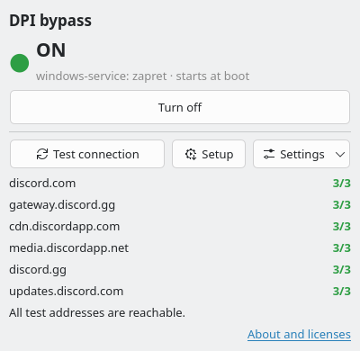
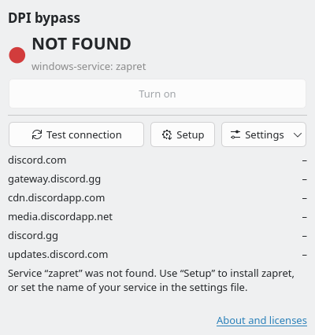
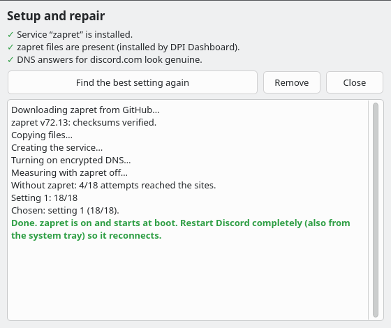
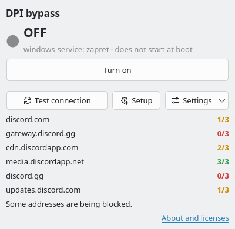
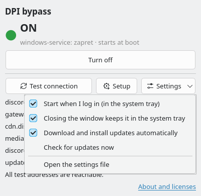
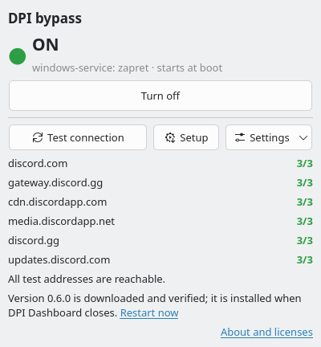
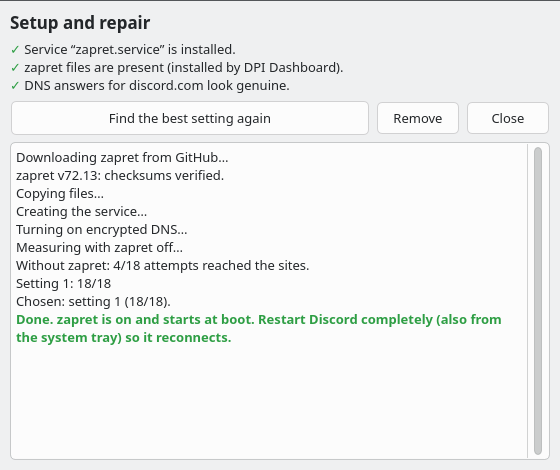
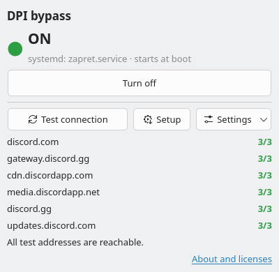

# DPI Dashboard

[Türkçe](README.tr.md)

A small desktop app to **turn a DPI-bypass service on and off**, **check whether it
actually works**, and **install one** if you have none — without touching a terminal.
Made for Discord in Turkey, works for any site and any provider that blocks by DPI.



Some internet providers block sites with deep packet inspection (DPI): the connection is
cut in the middle of the TLS handshake as soon as the site name is seen. Tools like
[zapret](https://github.com/bol-van/zapret) and [GoodbyeDPI](https://github.com/ValdikSS/GoodbyeDPI)
get around this, but they run as system services that you normally set up, start and
stop from the command line. DPI Dashboard does that for you.

> **DPI Dashboard does not bypass anything by itself.** It controls a bypass service.
> If you do not have one yet, its **Setup** button installs
> [zapret](https://github.com/bol-van/zapret) and finds a setting that works on your
> connection.

## Contents

- [Features](#features)
- [Quick start](#quick-start)
- [Windows guide](#windows-guide)
- [Linux guide](#linux-guide)
- [Supported systems](#supported-systems)
- [How Setup works](#how-setup-works)
- [Settings](#settings)
- [Command line](#command-line)
- [Security](#security)
- [Troubleshooting](#troubleshooting)
- [Development](#development) · [License](#license)

## Features

- **On/off with one button.** "On" also starts the service at boot, "off" stops it.
  Live status: on, off, or not installed.
- **Connection test** against a list of sites (Discord by default), three attempts each.
  It tells *how* a failed attempt failed: connection reset (the usual DPI signature),
  timeout, DNS failure, or a rejected certificate.
- **Setup** for a computer that has nothing yet: downloads and verifies zapret, installs
  it as a service, switches to DNS your provider cannot forge, and measures a list of
  strategies to keep the one that works on your connection. Covers Discord voice (UDP)
  too. **Remove** undoes all of it.
- **System tray** icon that shows the state at a glance, with a menu to turn the service
  on or off and run the test. Closing the window keeps the app in the tray.
- **Start at login**, straight into the tray.
- **Updates itself** from the GitHub releases, after checking each download's checksum.
- Asks for the administrator password each time something changes (UAC on Windows,
  polkit on Linux). No permanent "passwordless" rule is installed.
- English and Turkish, picked from the system language.
- Windows 10/11 and Linux with systemd.

## Quick start

| | Windows 10 / 11 | Linux |
|---|---|---|
| 1. Get it | Download `dpi-dashboard-<version>-windows-x64.exe` from [Releases](https://github.com/hamer1818/dpi-dashboard/releases/latest) | `git clone https://github.com/hamer1818/dpi-dashboard.git && cd dpi-dashboard && ./scripts/install-linux.sh` |
| 2. Install the bypass | Start it, **Setup → Install zapret and find a working setting**, confirm the administrator prompt | same, confirm the password prompt |
| 3. Check | **Test connection**: every line green (3/3) | same |
| 4. Keep it running | **Settings → Start when I log in** | same |

After Setup, **restart Discord completely** (also quit it from the system tray), so it
reconnects through the bypass and the new DNS.

## Windows guide

### What you need

- Windows 10 or 11, 64-bit (x64). Windows on ARM does not work: the WinDivert driver
  zapret uses has no ARM version.
- An administrator account, or its password, for Setup and for turning the service on or
  off.
- Nothing else: the `.exe` contains everything. Python is not needed.

### 1. Download and start

1. Open [Releases](https://github.com/hamer1818/dpi-dashboard/releases/latest) and
   download `dpi-dashboard-<version>-windows-x64.exe`.
2. Put it where it can stay, for example in a `DPI Dashboard` folder in Documents.
   Updates replace this file in place, and "Start when I log in" points to it, so do
   not leave it in a folder you clean up.
3. Double-click it. The file is not code-signed, so SmartScreen may say "Windows protected
   your PC": choose **More info → Run anyway**. To check that the file is genuine, see
   [Checking a download](#checking-a-download).

There is no installer: the program is this one file. Its settings are stored in
`%APPDATA%\dpi-dashboard\config.json`.

### 2. First start: no service yet

On a computer without a bypass service the window shows **NOT FOUND**:



If you already use zapret (for example the `service.bat` of
[zapret-discord-youtube](https://github.com/Flowseal/zapret-discord-youtube)) or
GoodbyeDPI as a service, DPI Dashboard finds it by itself (`zapret`, `winws1`,
`GoodbyeDPI`) and you can skip to step 4. It only turns such a service on and off; its
settings stay with the tool that installed it.

### 3. Setup

Click **Setup**. The window lists what it found and offers
**Install zapret and find a working setting**. The confirmation says exactly what will
happen; one administrator (UAC) prompt follows. Then it:

1. downloads the latest [zapret](https://github.com/bol-van/zapret/releases) release and
   checks its checksums,
2. copies `winws` and the WinDivert driver to `C:\Program Files\zapret` and creates the
   `zapret` service,
3. switches the DNS of your connected network adapters to Cloudflare (1.1.1.1), so DNS
   answers cannot be forged. Windows 11 encrypts it (DNS over HTTPS); Windows 10 has no
   system-wide encrypted DNS, so there it is plain DNS to Cloudflare. **Remove** puts your
   previous DNS servers back,
4. measures the test sites with zapret off, then tries the strategies one by one and
   keeps the first that reaches all of them,
5. turns the service on and sets it to start with Windows.

It takes one to three minutes. Web connections may drop for a few seconds while
strategies are tried.



"Without zapret: 4/18" is the measurement before the bypass, "Setting 1: 18/18" the
result with it. If even the best strategy misses some sites, Setup says so; see
[Troubleshooting](#troubleshooting).

**Restart Discord completely** afterwards (right-click its tray icon → Quit Discord,
then start it again).

### 4. Everyday use


- **Turn off / Turn on** stops or starts zapret (and whether it starts with Windows).
  Each switch asks for the administrator password.
- **Test connection** tries each site three times. Green 3/3: reachable every time.
  Amber: some attempts were blocked. Red 0/3: blocked. Hover over a number to see why
  an attempt failed.



This is what the test looks like while blocking is still active: the provider cuts some
connections, not all, so Discord may half work. Turn zapret on, or run Setup again.

### 5. Tray, start with Windows and updates

The **Settings** button is a menu:



- **Start when I log in (in the system tray)** — starts with Windows, without opening
  the window. Stored as `DPI Dashboard` in
  `HKCU\Software\Microsoft\Windows\CurrentVersion\Run`, for your account only.
- **Closing the window keeps it in the system tray** — on by default. To quit, use
  **Quit** in the tray icon's menu.
- **Download and install updates automatically** — on by default.
- **Check for updates now**, and **Open the settings file**.

The tray icon shows the state: green on, gray off, red not installed. Click it to show
or hide the window; right-click for the menu. Windows 11 may put it behind the **^**
arrow in the taskbar; drag it out to keep it visible.


When an update is out, the app downloads it in the background, checks it, and shows:



**Restart now** switches to it right away; otherwise it is installed when the app
quits. The `.exe` keeps its name and place, so shortcuts and "Start when I log in" keep
working. Updates never need the administrator password.

### 6. Find the best setting again

Providers change how they block. If sites start failing again, open **Setup → Find the
best setting again**. It measures again with the current strategy list and keeps the
best one; if nothing helps, your previous setting is put back.

### 7. Remove everything

1. **Setup → Remove**: stops and deletes the `zapret` service, deletes
   `C:\Program Files\zapret`, and restores your previous DNS servers.
2. **Settings → Start when I log in**: turn it off.
3. Quit the app from the tray icon and delete the `.exe`.
4. Optionally delete `%APPDATA%\dpi-dashboard` (settings) and
   `%ProgramData%\dpi-dashboard` (setup logs).

## Linux guide

### What you need

- A distribution with **systemd** and **Python 3.10** or newer, see
  [Supported systems](#supported-systems).
- **polkit** with an authentication agent, for the password prompt. KDE Plasma, GNOME,
  Cinnamon, Xfce and MATE start one. Bare window managers (i3, Sway, Hyprland…) need one
  started, for example `polkit-gnome` or `lxqt-policykit`.
- `git` to download it.

Distribution packages needed before installing:

| Distribution | Command |
|---|---|
| Debian / Ubuntu / Mint / Pop!_OS | `sudo apt install git python3-venv` (and `python3-pyqt6` to avoid a 100 MB download) |
| Fedora | `sudo dnf install git python3-pyqt6` |
| Arch / Manjaro / EndeavourOS / CachyOS | `sudo pacman -S --needed git python-pyqt6` |
| openSUSE Tumbleweed | `sudo zypper install git python3-PyQt6` |

PyQt6 from the distribution is optional; without it, the install script downloads it
from PyPI.

### 1. Install

```bash
git clone https://github.com/hamer1818/dpi-dashboard.git
cd dpi-dashboard
./scripts/install-linux.sh
```

Then search for **DPI Dashboard** in your application menu (`dpi`, `zapret` and
`discord` also find it). Everything goes into your home folder
(`~/.local/share/dpi-dashboard`); no root is needed. You can delete the cloned folder
afterwards: updates come from the GitHub releases.

### 2. Setup

If zapret is not installed, the window shows **NOT FOUND**. Click **Setup → Install zapret
and find a working setting** and enter your password once. Setup:

1. downloads the latest zapret release and checks its checksums,
2. installs missing tools with your package manager (`curl`, `nftables`, `gawk`;
   pacman, apt, dnf or zypper),
3. copies zapret to `/opt/zapret` and creates `zapret.service`,
4. turns on encrypted DNS (DNS-over-TLS to Quad9 and Cloudflare) if your system uses
   systemd-resolved; otherwise DNS is left alone,
5. measures, tries the strategies, keeps the best and enables the service.



**Already have zapret?** An install from the AUR (`zapret`, `zapret-git`) or from
zapret's own `install_easy.sh` is detected as `zapret.service`. Setup then offers
**Find the best setting again**, which only rewrites the strategy in `/opt/zapret/config`
(a backup is kept), and never deletes it. On Linux, the GoodbyeDPI-style Windows
services do not exist; set the name of any other systemd service in the settings.

### 3. Everyday use, tray and updates

The window works as on Windows:



- **Tray icon**: KDE Plasma, Cinnamon, Xfce, MATE and most panels show it. **GNOME**
  shows tray icons only with the
  [AppIndicator extension](https://extensions.gnome.org/extension/615/appindicator-support/)
  (installed by default on Ubuntu). Without a tray, closing the window quits the app.
- **Start when I log in** writes `~/.config/autostart/dpi-dashboard.desktop`.
- **Updates**: the install from `install-linux.sh` updates itself — it downloads the
  release's wheel, checks it, and installs it into its own environment when the app
  restarts or quits. Installs with `pip` or from a distribution package only show a
  notice with a link.

### 4. Remove everything

```bash
# in the app: Setup → Remove   (deletes zapret.service, /opt/zapret and the DNS change)
./scripts/uninstall-linux.sh   # removes the app, its menu entry and the autostart entry
```

Your settings stay in `~/.config/dpi-dashboard/`; delete that folder too if you want.
A zapret from a distribution package is never deleted by DPI Dashboard; remove it with
your package manager.

### Other ways to install

```bash
pip install git+https://github.com/hamer1818/dpi-dashboard.git
dpi-dashboard
```

This adds no menu entry and does not update itself; use the install script for that.

## Supported systems

**Tested automatically on every change** (a real install, retune and removal, see the
`setup` jobs in [CI](.github/workflows/ci.yml)):

| System | Notes |
|---|---|
| Windows (CI: Windows Server, the Windows 10/11 code base) | through the same UAC path users take; also tested by hand on Windows 10 and 11 |
| Ubuntu (current LTS) | |
| Debian 12 | setup installed missing `curl` and `nftables` |
| Fedora (latest) | setup installed missing `nftables` |
| Arch Linux | |
| openSUSE Tumbleweed | setup installed missing `gawk` and `nftables` |

**Expected to work, not tested:** distributions built on the ones above with systemd and
Python 3.10 or newer, for example Linux Mint 21+, Pop!_OS 22.04+, Zorin OS 17+,
elementary OS 7+, Manjaro, EndeavourOS, CachyOS, Garuda, Nobara, Ubuntu 22.04.
On Fedora/RHEL-like systems with SELinux enforcing, setup relabels `/opt/zapret`
(`restorecon`); this cannot be tested in CI, which runs without SELinux. Please report
the result if you use one.

**Not supported:**

| System | Why |
|---|---|
| No systemd: Alpine, Void, Gentoo with OpenRC, Artix, Devuan, antiX | the Linux backend and setup use systemd |
| Python older than 3.10: Debian 11, Ubuntu 20.04, openSUSE Leap 15, RHEL/Alma/Rocky 8–9 with the default Python | the install script stops and says so |
| NixOS | system files are managed by Nix; install zapret through Nix, then the on/off switch works |
| Immutable systems: Fedora Silverblue/Kinoite/Bazzite, SteamOS, openSUSE Aeon/MicroOS | setup cannot install packages there; the on/off switch works if zapret is installed another way |
| WSL, macOS, Windows on ARM | no bypass service to control (WinDivert has no ARM driver) |

## How Setup works

**Measuring.** Each test site is tried `tries` times (3) with zapret off, then with each
strategy. Blocking is often intermittent — on Turk Telekom about half of the connections
get through without a bypass — so a single attempt says little. Setup keeps the first
strategy that reaches every site, or the best one if none does, and says so.

**Strategies.** The list, in order, is in
[`setup/strategies.py`](src/dpi_dashboard/setup/strategies.py). It was measured on Turk
Telekom: strategies that first send a fake request the DPI takes for the real one
(`fake` with `md5sig` / `badseq` and a randomized fake TLS hello, or `autottl`) reached
every site on both Linux and Windows; splitting the request alone worked on Linux but not
with `winws` on Windows. Put your own (for example from zapret's `blockcheck.sh`) in the
`strategies` setting.

**What the service covers.** HTTPS on port 443 (the tuned part), HTTP on port 80, Discord
voice over UDP (STUN and Discord's IP discovery, ports 19294–19344 and 50000–50100), QUIC
(UDP 443) and Cloudflare's extra TLS ports (2053, 2083, 2087, 2096, 8443). On Windows
this is the command line of the `zapret` service; on Linux, `NFQWS_OPT` and the port
lists in `/opt/zapret/config`.

**DNS.** Many providers also answer DNS questions for blocked sites with a wrong address,
which no DPI bypass fixes. Setup compares your DNS answers with DNS over HTTPS and shows
the result, and switches to Cloudflare (Windows) or DNS-over-TLS (Linux with
systemd-resolved) as part of the install. The previous servers are saved and restored by
**Remove**.

**Logs.** Windows: `%ProgramData%\dpi-dashboard\logs\` (one file per run; users can read,
not change them). Linux: the messages in the Setup window, and `journalctl -u zapret`.

## Settings

**Settings → Open the settings file** opens it, creating it with defaults on first use:

- Windows: `%APPDATA%\dpi-dashboard\config.json`
- Linux: `~/.config/dpi-dashboard/config.json`

```json
{
  "backend": "auto",
  "service": null,
  "hosts": ["discord.com", "gateway.discord.gg", "cdn.discordapp.com",
            "media.discordapp.net", "discord.gg", "updates.discord.com"],
  "tries": 3,
  "timeout": 6.0,
  "language": "auto",
  "refresh_seconds": 2.0,
  "strategies": ["--dpi-desync=fake,multidisorder --dpi-desync-split-pos=1,midsld ...", "..."],
  "auto_update": true,
  "close_to_tray": true
}
```

| Key | Meaning |
|---|---|
| `backend` | `auto`, `systemd` or `windows-service` |
| `service` | Service name. `null` tries the known names (`zapret.service` on Linux; `zapret`, `winws1`, `GoodbyeDPI` on Windows). |
| `hosts` | Sites used by the connection test and by Setup. Put the sites you care about here. |
| `tries` | Attempts per site. Blocking is often intermittent, so one attempt is not enough. |
| `timeout` | Seconds per attempt. |
| `language` | `auto`, `en` or `tr` |
| `refresh_seconds` | How often the status is re-read. |
| `strategies` | zapret options for HTTPS that Setup tries, in order. Only plain option characters are accepted. |
| `auto_update` | Download and install new releases by itself. `false`: only show that one is available. |
| `close_to_tray` | Closing the window keeps the app running in the system tray. |

Invalid values are ignored and reported in the window. Restart the app after editing.
"Start when I log in" is not stored here but in the system (see the guides above).

## Command line

```bash
dpi-dashboard                 # the window
dpi-dashboard --minimized     # start in the tray (used by "Start when I log in")
dpi-dashboard --version

python -m dpi_dashboard.setup check                  # what Setup would show, as JSON
python -m dpi_dashboard.setup install --dns-dot      # or: tune, uninstall
```

On Windows, use the `.exe` path instead of `dpi-dashboard`. From the command line, the DNS
change is opt-in (`--dns-dot`). Starting the app while it already runs brings the
running window to the front.

## Security

**What runs with administrator rights.** Turning the service on or off runs
`systemctl enable|disable --now <service>` through `pkexec` (Linux) or `Set-Service` /
`Start-Service` / `Stop-Service` through UAC (Windows). Setup runs a helper script that
ships with the app. That script is never run from a file a normal user can change: on
Linux it is piped into `pkexec /bin/bash`, on Windows it is compressed into the elevated
command line. The helper downloads zapret itself, into a folder only administrators can
write, checks it (GitHub's SHA-256 for the whole archive, which also covers the install
scripts; upstream's `sha256sum.txt` for every program) and refuses archives with paths or
links that leave the folder. Only then is anything installed.

**What is checked before it reaches a shell or the registry.** Strategies, host names,
service names and the Windows log name are validated against strict patterns.

**Updates.** The app updates only itself, never with administrator rights, from the
releases of this repository: the file must come from a
`github.com/hamer1818/dpi-dashboard/releases/download/` URL and match both the release's
`SHA256SUMS` and the SHA-256 GitHub publishes for it. Both come from GitHub, so this
protects against broken or swapped downloads, not against someone who controls the
repository. Turn it off with `"auto_update": false`.

**Network.** Nothing listens on the network and there is no telemetry. Requests go to
`api.github.com` / `github.com` (setup, update check), the sites in your settings
(connection test) and `cloudflare-dns.com` or `dns.google` (the DNS check asks them for
the first test site). The DNS change sends your DNS queries to Cloudflare (Windows) or
Quad9 and Cloudflare (Linux).

**Risks that come with zapret itself.** zapret inspects and rewrites your web traffic.
On Linux, `nfqws` drops to an unprivileged user. On Windows, `winws` runs as LocalSystem
with the WinDivert kernel driver, as it does with zapret's own installers; a flaw in
`winws` would be a flaw in a privileged process that sees your web traffic. To update
zapret, use **Remove** and install again.

**What it cannot protect against.** If malware already runs as your user, it can change
DPI Dashboard itself (installed in your home folder, or the `.exe`) before you start it,
and anything you then authorise with your password is in its hands. No program installed
per user can prevent that. What DPI Dashboard does prevent is files being swapped while
it is running with administrator rights.

### Checking a download

Every release lists `SHA256SUMS` and has a signed build provenance that ties each file to
the GitHub workflow that built it:

```bash
gh attestation verify dpi-dashboard-<version>-windows-x64.exe --repo hamer1818/dpi-dashboard
```

On Windows without `gh`, compare the checksum by hand in PowerShell:
`Get-FileHash .\dpi-dashboard-<version>-windows-x64.exe` must match the line in
`SHA256SUMS`.

Release builds install their dependencies from hash-locked lists
(`packaging/requirements/`), GitHub Actions are pinned to commit SHAs, and workflows run
with read-only tokens except for the final publishing step.

Found a vulnerability? Please report it privately, see [SECURITY.md](SECURITY.md).

## Troubleshooting

**Discord opens but slowly, or voice stays at "RTC connecting".** Restart Discord
completely after Setup. Then run **Test connection**: if lines are amber or red, run
**Setup → Find the best setting again**.

**Setup says "Some test sites are still unreachable with the best setting".** None of the
strategies reached every site. Try again later (blocking changes during the day), or
find one with zapret's `blockcheck.sh` and put it first in the `strategies` setting.

**"NOT FOUND" although a service is installed.** It has another name. Check with
`sc query state= all | findstr /i "zapret winws goodbye"` (Windows) or
`systemctl list-unit-files | grep -i zapret` (Linux) and put the name in the `service`
setting.

**Windows: SmartScreen blocks the file.** **More info → Run anyway**. The file is not
code-signed; see [Checking a download](#checking-a-download).

**Windows: the service does not start after Setup.** Antivirus software sometimes blocks
WinDivert, the driver zapret uses. Check its quarantine and allow
`C:\Program Files\zapret`.

**Windows: what did Setup do?** Open **PowerShell** (not Command Prompt; in a Command
Prompt window, type `powershell` first) and run:

```powershell
Get-ChildItem "$env:ProgramData\dpi-dashboard\logs" | Sort-Object LastWriteTime | Select-Object -Last 1 | Get-Content
```

`@@BASELINE` is the result without zapret, `@@TRY n` the result of each strategy and
`@@CHOSEN` the one kept. Please attach this when you report a problem.

**Linux: nothing happens when I press the button.** No polkit authentication agent is
running; see [What you need](#what-you-need-1).

**Linux (GNOME): no tray icon.** Install the AppIndicator extension, see the
[Linux guide](#3-everyday-use-tray-and-updates).

**"name not resolved (DNS)" or wrong results only for some sites.** Your provider also
falsifies DNS. Setup switches DNS for you; if you skipped it (command line without
`--dns-dot`), run **Setup → Find the best setting again** from the window.

**"certificate rejected".** Something between you and the site is presenting a different
certificate. Treat that connection as untrusted.

## Legal note

Whether bypassing network filtering is allowed depends on where you are. You are
responsible for how you use this software. It is provided without warranty, see the
[license](LICENSE).

## Development

```bash
python -m venv .venv && . .venv/bin/activate
pip install -e ".[dev]"
QT_QPA_PLATFORM=offscreen pytest
ruff check .
```

Build the Windows executable (on Windows; the release build uses the hash-locked
`packaging/requirements/release-windows.txt`):

```bash
pip install . pyinstaller
pyinstaller --onefile --windowed --name dpi-dashboard --icon src/dpi_dashboard/assets/icon.ico --collect-data dpi_dashboard packaging/windows/entry.py
```

Regenerate the screenshots in `docs/screenshots/` with
`PYTHONPATH=src python scripts/screenshots.py`.

New backends live in `src/dpi_dashboard/backends/`: implement `state()` and
`set_enabled()` from `Backend` and register the class in `KINDS`. The setup helpers are
`src/dpi_dashboard/assets/setup-linux.sh` and `setup-windows.ps1`; they report to the app
with `@@` lines on stdout (Linux) or in a protected log file (Windows), see
`setup/runner.py`, which also documents the security boundary. Self-updates are in
`updater.py`, start at login in `autostart.py`.

[CI](.github/workflows/ci.yml) is one workflow: tests on Linux and Windows, a real
install, retune and removal on fresh Ubuntu, Debian, Fedora, Arch, openSUSE and Windows
machines, and the builds. A `v*` tag publishes a release once all of it passes.

Bug reports and pull requests are welcome. If you use a bypass tool with a service name
that is not detected automatically, please open an issue with the name.

## License

The source code is under the [MIT license](LICENSE).

The Windows program also contains PyQt6, which is licensed under the GNU GPL v3, so the
`.exe` as a whole is distributed under the GPL v3. The Python package and the Linux
install contain only DPI Dashboard's own code. Every bundled part, its license and where
to get its source are listed in [THIRD_PARTY_NOTICES.md](THIRD_PARTY_NOTICES.md); the
license texts are in [`licenses/`](licenses/), inside the program, and in each release's
`*-licenses.zip`. The app shows this under **About and licenses**.
