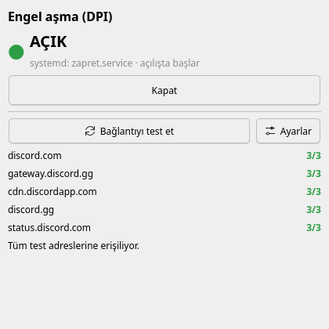

# DPI Dashboard

[English](README.md)

Engel aşma (DPI bypass) servisini **tek tıkla açıp kapatan** ve **gerçekten çalışıp
çalışmadığını test eden** küçük bir masaüstü penceresi. Terminale gerek yok.



Bazı internet sağlayıcıları siteleri derin paket incelemesiyle (DPI) engeller: site adı
görüldüğü anda TLS el sıkışmasının ortasında bağlantı kesilir.
[zapret](https://github.com/bol-van/zapret) ve
[GoodbyeDPI](https://github.com/ValdikSS/GoodbyeDPI) gibi araçlar bunu aşar, ama sistem
servisi olarak çalışırlar ve normalde komut satırından açılıp kapatılırlar. DPI
Dashboard o servisin arayüzüdür.

> **DPI Dashboard kendi başına hiçbir engeli aşmaz.** Bir engel aşma servisini yönetir.
> Henüz yoksa **Kurulum** düğmesi [zapret](https://github.com/bol-van/zapret)'i sizin için
> kurabilir, bkz. [Kurulum](#kurulum-düğmesi).

## Özellikler

- Servisi tek düğmeyle açıp kapatma. Açılışta başlayıp başlamayacağını da birlikte ayarlar.
- Canlı durum: açık/kapalı ve açılışta başlayıp başlamadığı.
- Bir site listesine (varsayılan Discord) birkaç denemeyle bağlantı testi. Başarısız
  denemenin **nasıl** başarısız olduğunu söyler: bağlantı kesildi (DPI'ın tipik
  belirtisi), zaman aşımı, DNS hatası ya da reddedilen sertifika.
- Her seferinde yönetici şifresi sorar (Linux'ta polkit, Windows'ta UAC). Kalıcı
  "şifresiz" bir kural kurmaz.
- Hiçbir şeyi olmayan bir bilgisayar için **Kurulum**: eksikleri bulur, zapret'i indirip
  doğrular, servis olarak kurar ve bağlantınızda çalışan bir ayar seçer. **Kaldır** geri alır.
- Türkçe ve İngilizce, sistem diline göre.
- Linux (systemd) ve Windows.

## Gereksinimler

| | Linux | Windows 10 / 11 |
|---|---|---|
| Engel aşma servisi | [zapret](https://github.com/bol-van/zapret)'in `zapret.service`'i (`install_easy.sh` ya da AUR `zapret` / `zapret-git`) | `zapret` adlı bir Windows servisi (örn. [zapret-discord-youtube](https://github.com/Flowseal/zapret-discord-youtube) `service.bat`) ya da `GoodbyeDPI` (GoodbyeDPI'ın `service_install_*.cmd` betikleri) |
| Servis yöneticisi | systemd | Windows servisleri |
| Şifre penceresi | Kimlik doğrulama ajanıyla polkit (KDE ve GNOME'da var) | UAC |
| Python (`.exe` kullanmıyorsanız) | 3.10+ ve PyQt6 | 3.10+ ve PyQt6 |

Bunlardan hiçbiri yoksa [Kurulum](#kurulum-düğmesi)'u kullanın. Servisinizin adı farklıysa
[ayar dosyasına](#ayarlar) yazın.

### Desteklenen sistemler

**Her değişiklikte otomatik test edilenler** (gerçek kurulum, yeniden ayarlama ve kaldırma,
bkz. [Setup integration](.github/workflows/setup-integration.yml)):

| Sistem | Not |
|---|---|
| Windows (CI: Windows Server, Windows 10/11 ile aynı temel) | kullanıcıların izlediği UAC yolundan; Windows 10'da elle de denendi |
| Ubuntu (güncel LTS) | |
| Debian 12 | kurulum eksik `curl` ve `nftables`'ı kurdu |
| Fedora (güncel) | kurulum eksik `nftables`'ı kurdu |
| Arch Linux | |
| openSUSE Tumbleweed | kurulum eksik `gawk` ve `nftables`'ı kurdu |

**Çalışması beklenen, test edilmeyenler:** yukarıdakilerin üzerine kurulu, systemd ve
Python 3.10+ kullanan dağıtımlar; örneğin Linux Mint 21+, Pop!_OS 22.04+, Zorin OS 17+,
elementary OS 7+, Manjaro, EndeavourOS, CachyOS, Garuda, Nobara, Ubuntu 22.04.
SELinux'un zorunlu olduğu Fedora/RHEL benzeri sistemlerde kurulum `/opt/zapret`'i yeniden
etiketler (`restorecon`); CI SELinux'suz çalıştığı için bu test edilemiyor. Kullanıyorsanız
sonucu bildirin.

**Desteklenmeyenler:**

| Sistem | Neden |
|---|---|
| systemd'siz: Alpine, Void, OpenRC'li Gentoo, Artix, Devuan, antiX | Linux tarafı ve kurulum systemd kullanır |
| Python 3.10'dan eski: Debian 11, Ubuntu 20.04, openSUSE Leap 15, varsayılan Python'lu RHEL/Alma/Rocky 8–9 | kurulum betiği durur ve nedenini söyler |
| NixOS | sistem dosyalarını Nix yönetir; zapret'i Nix ile kurun, açma-kapama çalışır |
| Değiştirilemez sistemler: Fedora Silverblue/Kinoite/Bazzite, SteamOS, openSUSE Aeon/MicroOS | kurulum oraya paket kuramaz; zapret başka yoldan kurulursa açma-kapama çalışır |
| WSL, macOS, ARM işlemcili Windows | yönetilecek engel aşma servisi yok (WinDivert'in ARM sürücüsü yok) |

Masaüstü ortamı olmayan pencere yöneticilerinde (i3, Sway, Hyprland, bspwm…) çalışan bir
polkit kimlik doğrulama ajanı gerekir, yoksa şifre penceresi hiç açılmaz.

## Kurulum

### Linux

```bash
git clone https://github.com/hamer1818/dpi-dashboard.git
cd dpi-dashboard
./scripts/install-linux.sh
```

Ardından uygulama menüsünde **DPI Dashboard** arayın (`dpi`, `zapret` ve `discord`
yazınca da çıkar). Her şey ev dizininize kurulur, root gerekmez. Dağıtımınızın PyQt6'sı
kuruluysa (`python-pyqt6`, `python3-pyqt6`) o kullanılır. Kaldırmak için:
`./scripts/uninstall-linux.sh`.

Debian/Ubuntu'da önce `sudo apt install python3-venv` gerekebilir.

### Windows

[Releases](https://github.com/hamer1818/dpi-dashboard/releases) sayfasından
`dpi-dashboard-<sürüm>-windows-x64.exe` dosyasını indirip çalıştırın. Kurulum adımı yok.

Dosya kod imzalı olmadığı için SmartScreen "bilinmeyen yayımcı" uyarısı verebilir:
**Ek bilgi → Yine de çalıştır**'ı seçin. Kendiniz de derleyebilirsiniz, bkz.
[Geliştirme](README.md#development).

## Kurulum düğmesi

**Kurulum** bilgisayarı kontrol edip bulduğunu gösterir: servis ve zapret dosyaları var
mı, hangi araçlar eksik, DNS cevapları sahte görünüyor mu. Sonra şunlardan birini sunar:

- **zapret'i kur ve çalışan ayarı bul** (henüz hiçbir şey kurulu değilse), ya da
- **En iyi ayarı yeniden bul** (zapret kurulu; örneğin sağlayıcınız engelleme biçimini
  değiştirdiyse).

Kurulum, yönetici şifresini bir kez sorarak şunları yapar:

1. Son sürümü [github.com/bol-van/zapret](https://github.com/bol-van/zapret/releases)'ten
   indirir. Arşiv GitHub'ın yayınladığı SHA-256 özetiyle, içindeki her program da
   upstream'in kendi `sha256sum.txt` listesiyle eşleşmek zorundadır. Eşleşmezse hiçbir şey
   kurulmaz.
2. Linux: `/opt/zapret`'e kopyalar, işlemcinize uygun programları bağlar
   (`install_bin.sh`), ayar dosyasını ve `zapret.service` birimini yazar. Eksik `curl` ya
   da `nftables` paket yöneticinizle kurulur (pacman, apt, dnf, zypper).
   Windows: `winws` ve WinDivert'i `%ProgramFiles%\zapret`'e kopyalar ve `zapret`
   servisini oluşturur.
3. Ayarlardaki siteleri zapret kapalıyken ölçer, sonra stratejileri tek tek dener ve
   hepsine ulaşan ilkini (ya da en iyisini) bırakır. Hiçbiri işe yaramazsa önceki ayarlar
   geri konur.
4. Servisi açar ve açılışta başlayacak şekilde ayarlar.

**Kaldır** servisi ve dosyaları siler. Sadece DPI Dashboard'un kurduğunu kaldırır:
dağıtım paketinden ya da başka bir kurulumdan gelen zapret asla silinmez. Windows'ta başka
bir araçla kurulmuş bir servis sadece açılıp kapatılır, ayarı değiştirilmez.

systemd-resolved kullanan Linux'larda DNS cevapları sahte görünürse kurulum şifreli DNS'i
(DNS-over-TLS) de açabilir. Windows'ta bunun yerine DNS over HTTPS'in nasıl açılacağını
gösterir.

Denenen stratejiler sırasıyla
[`setup/strategies.py`](src/dpi_dashboard/setup/strategies.py)'de. Kendi stratejilerinizi
`strategies` ayarına yazabilirsiniz. Aynı adımlar terminalden de çalıştırılabilir:

```bash
python -m dpi_dashboard.setup check
python -m dpi_dashboard.setup install      # ya da: tune, uninstall
```

## Ayarlar

**Ayarlar** düğmesi ayar dosyasını açar, ilk kullanımda varsayılanlarla oluşturur:

- Linux: `~/.config/dpi-dashboard/config.json`
- Windows: `%APPDATA%\dpi-dashboard\config.json`

| Anahtar | Anlamı |
|---|---|
| `backend` | `auto`, `systemd` ya da `windows-service` |
| `service` | Servis adı. `null` bilinen adları dener (Linux'ta `zapret.service`; Windows'ta önce `zapret`, sonra `GoodbyeDPI`). |
| `hosts` | Bağlantı testinde kullanılan siteler. Önem verdiğiniz siteleri yazın. |
| `tries` | Site başına deneme sayısı. DPI engeli çoğu zaman aralıklıdır, tek deneme yetmez. |
| `timeout` | Deneme başına saniye. |
| `language` | `auto`, `en` ya da `tr` |
| `refresh_seconds` | Durumun ne sıklıkla yeniden okunacağı. |
| `strategies` | Kurulumun sırayla denediği HTTPS zapret seçenekleri. Sadece düz seçenek karakterleri kabul edilir. |

Geçersiz değerler yok sayılır ve pencerede bildirilir. Düzenledikten sonra uygulamayı
yeniden başlatın.

## Sorun giderme

**"BULUNAMADI".** Servis kurulu değil ya da adı farklı. Linux'ta
`systemctl list-unit-files | grep -i zapret`, Windows'ta
`sc query state= all | findstr /i "zapret goodbye"` ile bakın ve adı ayar dosyasına yazın.

**Düğmeye basınca hiçbir şey olmuyor (Linux).** Çalışan bir polkit kimlik doğrulama
ajanı yok. KDE ve GNOME gibi masaüstleri bunu kendisi başlatır. Sade pencere
yöneticilerinde eklenmesi gerekir (örn. `polkit-gnome` ya da `lxqt-policykit`).

**Servis açık ama siteler hâlâ "bağlantı kesildi" diyor.** Strateji sağlayıcınızın
engelleme biçimine uymuyor. **Kurulum → En iyi ayarı yeniden bul**'u çalıştırın. Hazır
stratejilerin hiçbiri işe yaramazsa zapret'in `blockcheck.sh`'ı bir tane bulabilir; onu
`strategies` ayarına ekleyin.

**Kurulum "hiçbir strateji işe yaramadı" diyor.** Önceki ayarlarınız geri kondu. Önce
DNS'i kontrol edin (aşağıda), sonra `blockcheck.sh`'ı deneyin.

**Windows: kurulumdan sonra servis başlamıyor.** Antivirüs yazılımları bazen zapret'in
kullandığı WinDivert sürücüsünü engeller. Karantinasına bakın. WinDivert ARM işlemcili
Windows'ta da çalışmaz.

**"ad çözülemedi (DNS)" ya da sadece bazı sitelerde yanlış sonuç.** Bazı sağlayıcılar
DNS cevaplarını da sahteler. Bunu DPI aşma düzeltmez. Şifreli DNS kullanın: Windows
11'in ağ ayarlarında ya da tarayıcıda DNS over HTTPS, Linux'ta systemd-resolved'da
`DNSOverTLS=yes`.

**"sertifika reddedildi".** Siteyle aranızdaki bir şey farklı bir sertifika sunuyor. O
bağlantıya güvenmeyin.

## Yasal not

Ağ filtrelemesini aşmanın yasal olup olmadığı bulunduğunuz yere göre değişir. Yazılımı
nasıl kullandığınızdan siz sorumlusunuz. Yazılım garantisiz sunulur, bkz.
[lisans](LICENSE).

## Lisans

[MIT](LICENSE)
