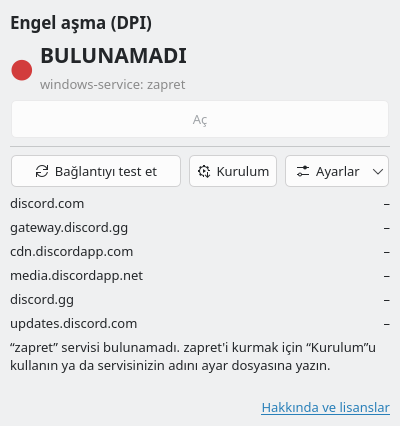
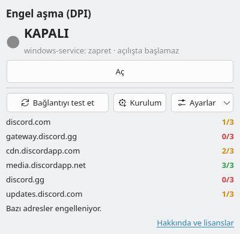
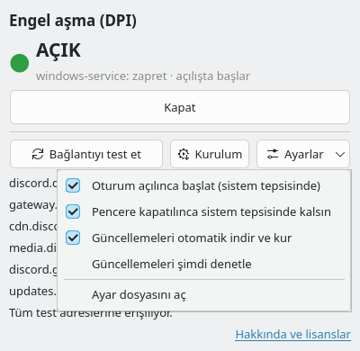
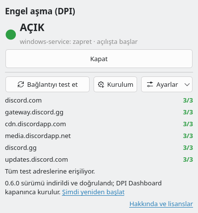
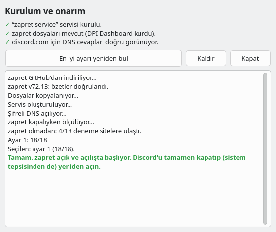
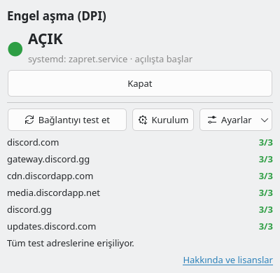

# DPI Dashboard

[English](README.md)

Bir DPI engel aşma servisini **açıp kapatmak**, **gerçekten çalışıp çalışmadığını test
etmek** ve hiç yoksa **kurmak** için küçük bir masaüstü uygulaması — terminale dokunmadan.
Türkiye'de Discord için yapıldı; DPI ile engelleyen her sağlayıcıda ve her sitede çalışır.


Bazı internet sağlayıcıları siteleri derin paket incelemesiyle (DPI) engeller: site adı
görüldüğü anda bağlantı TLS el sıkışmasının ortasında kesilir.
[zapret](https://github.com/bol-van/zapret) ve [GoodbyeDPI](https://github.com/ValdikSS/GoodbyeDPI)
gibi araçlar bunu aşar, ama normalde komut satırından kurulan, açılıp kapatılan sistem
servisleri olarak çalışırlar. DPI Dashboard bunu sizin yerinize yapar.

> **DPI Dashboard tek başına hiçbir engeli aşmaz.** Bir engel aşma servisini yönetir.
> Henüz yoksa **Kurulum** düğmesi [zapret](https://github.com/bol-van/zapret)'i kurar ve
> bağlantınızda çalışan bir ayar bulur.

## İçindekiler

- [Özellikler](#özellikler)
- [Hızlı başlangıç](#hızlı-başlangıç)
- [Windows rehberi](#windows-rehberi)
- [Linux rehberi](#linux-rehberi)
- [Desteklenen sistemler](#desteklenen-sistemler)
- [Kurulum nasıl çalışır](#kurulum-nasıl-çalışır)
- [Ayarlar](#ayarlar)
- [Komut satırı](#komut-satırı)
- [Güvenlik](#güvenlik)
- [Sorun giderme](#sorun-giderme)
- [Geliştirme](#geliştirme) · [Lisans](#lisans)

## Özellikler

- **Tek düğmeyle aç/kapat.** "Aç" servisi açılışta da başlatır, "Kapat" durdurur. Canlı
  durum: açık, kapalı ya da kurulu değil.
- **Bağlantı testi:** bir site listesine (varsayılan Discord) her birine üç deneme.
  Başarısız denemenin **nasıl** başarısız olduğunu söyler: bağlantı kesildi (DPI'ın tipik
  belirtisi), zaman aşımı, DNS hatası ya da reddedilen sertifika.
- Hiçbir şeyi olmayan bir bilgisayar için **Kurulum**: zapret'i indirip doğrular, servis
  olarak kurar, sağlayıcının sahteleyemeyeceği bir DNS'e geçer ve bir strateji listesini
  ölçüp bağlantınızda çalışanı bırakır. Discord sesini (UDP) de kapsar. **Kaldır** hepsini
  geri alır.
- Durumu bir bakışta gösteren **sistem tepsisi** simgesi; menüsünden servisi açıp kapatma
  ve test. Pencereyi kapatınca uygulama tepside çalışmaya devam eder.
- **Oturum açılınca başlatma**, doğrudan tepside.
- GitHub sürümlerinden **kendini günceller**, her indirmenin özetini doğruladıktan sonra.
- Bir şey değiştiğinde her seferinde yönetici şifresi sorar (Windows'ta UAC, Linux'ta
  polkit). Kalıcı "şifresiz" bir kural kurmaz.
- Türkçe ve İngilizce, sistem diline göre.
- Windows 10/11 ve systemd kullanan Linux.

## Hızlı başlangıç

| | Windows 10 / 11 | Linux |
|---|---|---|
| 1. İndir | [Releases](https://github.com/hamer1818/dpi-dashboard/releases/latest) sayfasından `dpi-dashboard-<sürüm>-windows-x64.exe` | `git clone https://github.com/hamer1818/dpi-dashboard.git && cd dpi-dashboard && ./scripts/install-linux.sh` |
| 2. Engel aşmayı kur | Açın, **Kurulum → zapret'i kur ve çalışan ayarı bul**, yönetici onayını verin | aynısı, şifrenizi girin |
| 3. Kontrol et | **Bağlantıyı test et**: bütün satırlar yeşil (3/3) | aynısı |
| 4. Hep açık kalsın | **Ayarlar → Oturum açılınca başlat** | aynısı |

Kurulumdan sonra **Discord'u tamamen kapatıp yeniden açın** (sistem tepsisinden de çıkın);
böylece engel aşma ve yeni DNS üzerinden yeniden bağlanır.

## Windows rehberi

### Gerekenler

- Windows 10 ya da 11, 64 bit (x64). ARM işlemcili Windows'ta çalışmaz: zapret'in
  kullandığı WinDivert sürücüsünün ARM sürümü yok.
- Kurulum ve servisi açıp kapatmak için bir yönetici hesabı ya da şifresi.
- Başka bir şey gerekmez: `.exe` her şeyi içerir, Python gerekmez.

### 1. İndirme ve başlatma

1. [Releases](https://github.com/hamer1818/dpi-dashboard/releases/latest) sayfasını açıp
   `dpi-dashboard-<sürüm>-windows-x64.exe` dosyasını indirin.
2. Kalıcı duracağı bir yere koyun, örneğin Belgeler'de bir `DPI Dashboard` klasörüne.
   Güncellemeler bu dosyayı yerinde değiştirir ve "Oturum açılınca başlat" bu dosyayı
   gösterir; temizlediğiniz bir klasörde bırakmayın.
3. Çift tıklayın. Dosya kod imzalı olmadığı için SmartScreen "Windows bilgisayarınızı
   korudu" diyebilir: **Ek bilgi → Yine de çalıştır**'ı seçin. Dosyanın gerçekten bu
   depodan geldiğini doğrulamak için bkz. [İndirilen dosyayı doğrulama](#indirilen-dosyayı-doğrulama).

Kurulum programı yoktur: program bu tek dosyadır. Ayarları
`%APPDATA%\dpi-dashboard\config.json` dosyasında durur.

### 2. İlk açılış: henüz servis yok

Engel aşma servisi olmayan bir bilgisayarda pencere **BULUNAMADI** gösterir:



Zaten servis olarak zapret (örneğin
[zapret-discord-youtube](https://github.com/Flowseal/zapret-discord-youtube)'un
`service.bat`'ı) ya da GoodbyeDPI kullanıyorsanız DPI Dashboard onu kendisi bulur
(`zapret`, `winws1`, `GoodbyeDPI`) ve 4. adıma geçebilirsiniz. Böyle bir servisi sadece
açıp kapatır; ayarları onu kuran araçta kalır.

### 3. Kurulum

**Kurulum**'a tıklayın. Pencere bulduklarını listeler ve
**zapret'i kur ve çalışan ayarı bul** seçeneğini sunar. Onay penceresi tam olarak ne
yapılacağını yazar; ardından bir yönetici (UAC) onayı gelir. Sonra kurulum:

1. son [zapret](https://github.com/bol-van/zapret/releases) sürümünü indirir ve
   özetlerini doğrular,
2. `winws` ve WinDivert sürücüsünü `C:\Program Files\zapret`'e kopyalar ve `zapret`
   servisini oluşturur,
3. DNS cevapları sahtelenemesin diye bağlı ağ bağdaştırıcılarınızın DNS'ini Cloudflare'e
   (1.1.1.1) çevirir. Windows 11 bunu şifreler (DNS over HTTPS); Windows 10'da sistem
   genelinde şifreli DNS olmadığından orada Cloudflare'e şifresiz DNS kullanılır.
   **Kaldır** önceki DNS sunucularınızı geri koyar,
4. test sitelerini zapret kapalıyken ölçer, sonra stratejileri tek tek dener ve hepsine
   ulaşan ilkini bırakır,
5. servisi açar ve Windows'la birlikte başlayacak şekilde ayarlar.

Bir ile üç dakika sürer. Stratejiler denenirken web bağlantıları birkaç saniye kopabilir.


"zapret olmadan: 4/18" engel aşma olmadan yapılan ölçüm, "Ayar 1: 18/18" onunla alınan
sonuçtur. En iyi strateji bile bazı sitelere ulaşamazsa kurulum bunu söyler; bkz.
[Sorun giderme](#sorun-giderme).

Sonra **Discord'u tamamen kapatıp yeniden açın** (tepsi simgesine sağ tık → Discord'dan
Çık, sonra yeniden başlatın).

### 4. Günlük kullanım


- **Kapat / Aç** zapret'i durdurur ya da başlatır (Windows'la başlayıp başlamayacağını da).
  Her değişiklikte yönetici şifresi sorulur.
- **Bağlantıyı test et** her siteyi üç kez dener. Yeşil 3/3: her seferinde ulaşıldı.
  Turuncu: bazı denemeler engellendi. Kırmızı 0/3: engelli. Bir denemenin neden başarısız
  olduğunu görmek için fareyle sayının üstüne gelin.



Engel hâlâ etkinken test böyle görünür: sağlayıcı bağlantıların hepsini değil bir kısmını
keser, bu yüzden Discord yarım çalışabilir. zapret'i açın ya da kurulumu yeniden çalıştırın.

### 5. Tepsi, Windows'la başlatma ve güncellemeler

**Ayarlar** düğmesi bir menüdür:



- **Oturum açılınca başlat (sistem tepsisinde)** — pencereyi açmadan Windows'la birlikte
  başlar. Sadece sizin hesabınız için,
  `HKCU\Software\Microsoft\Windows\CurrentVersion\Run` altında `DPI Dashboard` olarak
  saklanır.
- **Pencere kapatılınca sistem tepsisinde kalsın** — varsayılan olarak açık. Tamamen
  kapatmak için tepsi simgesinin menüsündeki **Çık**'ı kullanın.
- **Güncellemeleri otomatik indir ve kur** — varsayılan olarak açık.
- **Güncellemeleri şimdi denetle** ve **Ayar dosyasını aç**.

Tepsi simgesi durumu gösterir: yeşil açık, gri kapalı, kırmızı kurulu değil. Pencereyi
göstermek ya da gizlemek için tıklayın; menü için sağ tıklayın. Windows 11 simgeyi görev
çubuğundaki **^** okunun arkasına koyabilir; görünür kalması için dışarı sürükleyin.


Yeni bir sürüm çıktığında uygulama onu arka planda indirir, doğrular ve şunu gösterir:



**Şimdi yeniden başlat** hemen yeni sürüme geçer; yoksa uygulama kapanırken kurulur.
`.exe`'nin adı ve yeri değişmez, kısayollar ve "Oturum açılınca başlat" çalışmaya devam
eder. Güncellemeler hiçbir zaman yönetici şifresi istemez.

### 6. En iyi ayarı yeniden bulma

Sağlayıcılar engelleme biçimini değiştirir. Siteler yeniden açılmamaya başlarsa
**Kurulum → En iyi ayarı yeniden bul**'u açın. Güncel strateji listesiyle yeniden ölçer
ve en iyisini bırakır; hiçbiri işe yaramazsa önceki ayarınız geri konur.

### 7. Her şeyi kaldırma

1. **Kurulum → Kaldır**: `zapret` servisini durdurup siler, `C:\Program Files\zapret`'i
   siler ve önceki DNS sunucularınızı geri koyar.
2. **Ayarlar → Oturum açılınca başlat**: işareti kaldırın.
3. Uygulamayı tepsi simgesinden kapatın ve `.exe`'yi silin.
4. İsterseniz `%APPDATA%\dpi-dashboard` (ayarlar) ve `%ProgramData%\dpi-dashboard`
   (kurulum logları) klasörlerini de silin.

## Linux rehberi

### Gerekenler

- **systemd** ve **Python 3.10** ya da üstü olan bir dağıtım, bkz.
  [Desteklenen sistemler](#desteklenen-sistemler).
- Şifre penceresi için kimlik doğrulama aracıyla birlikte **polkit**. KDE Plasma, GNOME,
  Cinnamon, Xfce ve MATE bunu başlatır. Yalın pencere yöneticilerinde (i3, Sway,
  Hyprland…) birinin başlatılması gerekir, örneğin `polkit-gnome` ya da `lxqt-policykit`.
- İndirmek için `git`.

Kurmadan önce gereken paketler:

| Dağıtım | Komut |
|---|---|
| Debian / Ubuntu / Mint / Pop!_OS | `sudo apt install git python3-venv` (100 MB indirmemek için `python3-pyqt6` de) |
| Fedora | `sudo dnf install git python3-pyqt6` |
| Arch / Manjaro / EndeavourOS / CachyOS | `sudo pacman -S --needed git python-pyqt6` |
| openSUSE Tumbleweed | `sudo zypper install git python3-PyQt6` |

Dağıtımın PyQt6'sı isteğe bağlıdır; yoksa kurulum betiği onu PyPI'dan indirir.

### 1. Kurulum

```bash
git clone https://github.com/hamer1818/dpi-dashboard.git
cd dpi-dashboard
./scripts/install-linux.sh
```

Sonra uygulama menünüzde **DPI Dashboard**'u arayın (`dpi`, `zapret` ve `discord` da
bulur). Her şey ev klasörünüze gider (`~/.local/share/dpi-dashboard`); root gerekmez.
İndirdiğiniz klasörü sonra silebilirsiniz: güncellemeler GitHub sürümlerinden gelir.

### 2. Kurulum düğmesi

zapret kurulu değilse pencere **BULUNAMADI** gösterir. **Kurulum → zapret'i kur ve çalışan
ayarı bul**'a tıklayıp şifrenizi bir kez girin. Kurulum:

1. son zapret sürümünü indirir ve özetlerini doğrular,
2. eksik araçları paket yöneticinizle kurar (`curl`, `nftables`, `gawk`; pacman, apt,
   dnf ya da zypper),
3. zapret'i `/opt/zapret`'e kopyalar ve `zapret.service`'i oluşturur,
4. sisteminiz systemd-resolved kullanıyorsa şifreli DNS'i açar (Quad9 ve Cloudflare'e
   DNS-over-TLS); kullanmıyorsa DNS'e dokunmaz,
5. ölçer, stratejileri dener, en iyisini bırakır ve servisi etkinleştirir.



**zapret zaten kurulu mu?** AUR'dan (`zapret`, `zapret-git`) ya da zapret'in kendi
`install_easy.sh`'ı ile yapılmış bir kurulum `zapret.service` olarak bulunur. Kurulum o
zaman **En iyi ayarı yeniden bul**'u sunar; bu sadece `/opt/zapret/config` içindeki
stratejiyi yeniden yazar (yedeğini alır) ve onu asla silmez. Başka bir systemd servisi
kullanıyorsanız adını ayarlara yazın.

### 3. Günlük kullanım, tepsi ve güncellemeler

Pencere Windows'taki gibi çalışır:



- **Tepsi simgesi**: KDE Plasma, Cinnamon, Xfce, MATE ve çoğu panel gösterir. **GNOME**
  tepsi simgelerini sadece
  [AppIndicator eklentisiyle](https://extensions.gnome.org/extension/615/appindicator-support/)
  gösterir (Ubuntu'da hazır gelir). Tepsi yoksa pencereyi kapatmak uygulamayı kapatır.
- **Oturum açılınca başlat** `~/.config/autostart/dpi-dashboard.desktop` dosyasını yazar.
- **Güncellemeler**: `install-linux.sh` ile yapılan kurulum kendini günceller — sürümün
  wheel dosyasını indirir, doğrular ve uygulama yeniden başlarken ya da kapanırken kendi
  ortamına kurar. `pip` ile ya da dağıtım paketinden yapılan kurulumlar sadece bağlantılı
  bir bildirim gösterir.

### 4. Her şeyi kaldırma

```bash
# uygulamada: Kurulum → Kaldır   (zapret.service, /opt/zapret ve DNS değişikliğini siler)
./scripts/uninstall-linux.sh     # uygulamayı, menü kaydını ve otomatik başlatmayı kaldırır
```

Ayarlarınız `~/.config/dpi-dashboard/` içinde kalır; isterseniz onu da silin. Dağıtım
paketinden gelen bir zapret'i DPI Dashboard asla silmez; onu paket yöneticinizle kaldırın.

### Başka kurulum yolları

```bash
pip install git+https://github.com/hamer1818/dpi-dashboard.git
dpi-dashboard
```

Bu menü kaydı eklemez ve kendini güncellemez; bunlar için kurulum betiğini kullanın.

## Desteklenen sistemler

**Her değişiklikte otomatik test edilenler** (gerçek kurulum, yeniden ayarlama ve kaldırma,
bkz. [CI](.github/workflows/ci.yml) içindeki `setup` işleri):

| Sistem | Notlar |
|---|---|
| Windows (CI: Windows Server, Windows 10/11 ile aynı kod tabanı) | kullanıcıların geçtiği UAC yolundan; Windows 10 ve 11'de elle de denendi |
| Ubuntu (güncel LTS) | |
| Debian 12 | kurulum eksik `curl` ve `nftables`'ı kurdu |
| Fedora (son sürüm) | kurulum eksik `nftables`'ı kurdu |
| Arch Linux | |
| openSUSE Tumbleweed | kurulum eksik `gawk` ve `nftables`'ı kurdu |

**Çalışması beklenen, test edilmeyen:** yukarıdakilere dayanan, systemd ve Python 3.10 ya
da üstü olan dağıtımlar; örneğin Linux Mint 21+, Pop!_OS 22.04+, Zorin OS 17+, elementary
OS 7+, Manjaro, EndeavourOS, CachyOS, Garuda, Nobara, Ubuntu 22.04. SELinux'un zorunlu
olduğu Fedora/RHEL benzeri sistemlerde kurulum `/opt/zapret`'i yeniden etiketler
(`restorecon`); SELinux'suz çalışan CI'da bu test edilemez. Kullanıyorsanız sonucu
bildirin.

**Desteklenmeyen:**

| Sistem | Neden |
|---|---|
| systemd'siz: Alpine, Void, OpenRC'li Gentoo, Artix, Devuan, antiX | Linux tarafı ve kurulum systemd kullanır |
| Python 3.10'dan eski: Debian 11, Ubuntu 20.04, openSUSE Leap 15, varsayılan Python'lu RHEL/Alma/Rocky 8–9 | kurulum betiği durur ve bunu söyler |
| NixOS | sistem dosyalarını Nix yönetir; zapret'i Nix ile kurun, aç/kapat düğmesi çalışır |
| Değiştirilemez sistemler: Fedora Silverblue/Kinoite/Bazzite, SteamOS, openSUSE Aeon/MicroOS | kurulum orada paket kuramaz; zapret başka yolla kuruluysa aç/kapat çalışır |
| WSL, macOS, ARM işlemcili Windows | yönetilecek engel aşma servisi yok (WinDivert'in ARM sürücüsü yok) |

## Kurulum nasıl çalışır

**Ölçüm.** Her test sitesi önce zapret kapalıyken, sonra her stratejiyle `tries` (3) kez
denenir. Engel çoğu zaman aralıklıdır — Türk Telekom'da engel aşma olmadan bağlantıların
yaklaşık yarısı geçer — bu yüzden tek deneme pek bir şey söylemez. Kurulum her siteye
ulaşan ilk stratejiyi, yoksa en iyisini bırakır ve bunu söyler.

**Stratejiler.** Sırasıyla liste
[`setup/strategies.py`](src/dpi_dashboard/setup/strategies.py) içinde. Türk Telekom'da
ölçüldü: önce DPI'ın gerçek istek sandığı sahte bir istek gönderen stratejiler (`md5sig` /
`badseq` ve rastgele sahte TLS hello ile `fake`, ya da `autottl`) hem Linux'ta hem
Windows'ta her siteye ulaştı; isteği sadece bölmek Linux'ta işe yaradı ama Windows'ta
`winws` ile yaramadı. Kendi stratejilerinizi (örneğin zapret'in `blockcheck.sh`'ından)
`strategies` ayarına yazabilirsiniz.

**Servisin kapsadıkları.** 443 portunda HTTPS (ayarlanan kısım), 80 portunda HTTP, UDP
üzerinden Discord sesi (STUN ve Discord'un IP keşfi, 19294–19344 ve 50000–50100
portları), QUIC (UDP 443) ve Cloudflare'in ek TLS portları (2053, 2083, 2087, 2096, 8443).
Windows'ta bu `zapret` servisinin komut satırıdır; Linux'ta `/opt/zapret/config` içindeki
`NFQWS_OPT` ve port listeleri.

**DNS.** Birçok sağlayıcı engelli sitelerin DNS sorularına da yanlış adresle cevap verir;
bunu hiçbir DPI aşma düzeltmez. Kurulum DNS cevaplarınızı DNS over HTTPS ile karşılaştırıp
sonucu gösterir ve kurulumun parçası olarak Cloudflare'e (Windows) ya da DNS-over-TLS'e
(systemd-resolved kullanan Linux) geçer. Önceki sunucular kaydedilir ve **Kaldır** onları
geri koyar.

**Loglar.** Windows: `%ProgramData%\dpi-dashboard\logs\` (her çalıştırmada bir dosya;
kullanıcılar okuyabilir, değiştiremez). Linux: Kurulum penceresindeki mesajlar ve
`journalctl -u zapret`.

## Ayarlar

**Ayarlar → Ayar dosyasını aç** dosyayı açar, ilk kullanımda varsayılanlarla oluşturur:

- Windows: `%APPDATA%\dpi-dashboard\config.json`
- Linux: `~/.config/dpi-dashboard/config.json`

```json
{
  "backend": "auto",
  "service": null,
  "hosts": ["discord.com", "gateway.discord.gg", "cdn.discordapp.com",
            "media.discordapp.net", "discord.gg", "updates.discord.com"],
  "tries": 3,
  "timeout": 6.0,
  "language": "auto",
  "refresh_seconds": 2.0,
  "strategies": ["--dpi-desync=fake,multidisorder --dpi-desync-split-pos=1,midsld ...", "..."],
  "auto_update": true,
  "close_to_tray": true
}
```

| Anahtar | Anlamı |
|---|---|
| `backend` | `auto`, `systemd` ya da `windows-service` |
| `service` | Servis adı. `null` bilinen adları dener (Linux'ta `zapret.service`; Windows'ta `zapret`, `winws1`, `GoodbyeDPI`). |
| `hosts` | Bağlantı testinin ve kurulumun kullandığı siteler. Önem verdiğiniz siteleri yazın. |
| `tries` | Site başına deneme sayısı. Engel çoğu zaman aralıklıdır, tek deneme yetmez. |
| `timeout` | Deneme başına saniye. |
| `language` | `auto`, `en` ya da `tr` |
| `refresh_seconds` | Durumun ne sıklıkla yeniden okunacağı. |
| `strategies` | Kurulumun sırayla denediği HTTPS zapret seçenekleri. Sadece düz seçenek karakterleri kabul edilir. |
| `auto_update` | Yeni sürümleri kendisi indirip kursun. `false`: sadece yeni sürüm olduğunu göstersin. |
| `close_to_tray` | Pencere kapatılınca uygulama sistem tepsisinde çalışmaya devam etsin. |

Geçersiz değerler yok sayılır ve pencerede bildirilir. Düzenledikten sonra uygulamayı
yeniden başlatın. "Oturum açılınca başlat" burada değil, sistemde saklanır (yukarıdaki
rehberlere bakın).

## Komut satırı

```bash
dpi-dashboard                 # pencere
dpi-dashboard --minimized     # tepside başlat ("Oturum açılınca başlat" bunu kullanır)
dpi-dashboard --version

python -m dpi_dashboard.setup check                  # kurulumun göstereceği, JSON olarak
python -m dpi_dashboard.setup install --dns-dot      # ya da: tune, uninstall
```

Windows'ta `dpi-dashboard` yerine `.exe`'nin yolunu kullanın. Komut satırında DNS
değişikliği isteğe bağlıdır (`--dns-dot`). Uygulama zaten çalışırken yeniden başlatılırsa
çalışan pencere öne gelir.

## Güvenlik

**Yönetici yetkisiyle ne çalışır.** Servisi açıp kapatmak `pkexec` (Linux) ya da UAC
(Windows) üzerinden `systemctl enable|disable --now <servis>` / `Set-Service`,
`Start-Service`, `Stop-Service` çalıştırır. Kurulum, uygulamayla gelen bir yardımcı betik
çalıştırır. Bu betik hiçbir zaman normal bir kullanıcının değiştirebileceği bir dosyadan
çalıştırılmaz: Linux'ta `pkexec /bin/bash`'e standart girdiyle verilir, Windows'ta
sıkıştırılıp yönetici komutunun içine gömülür. Yardımcı zapret'i kendisi, yalnızca
yöneticilerin yazabildiği bir klasöre indirir, doğrular (arşivin tamamı için GitHub'ın
SHA-256'sı, ki kurulum betiklerini de kapsar; her program için upstream'in
`sha256sum.txt`'i) ve klasörün dışına çıkan yol ya da bağlantı içeren arşivleri reddeder.
Ancak bundan sonra bir şey kurulur.

**Kabuğa ya da kayıt defterine ulaşmadan önce denetlenenler.** Stratejiler, site adları,
servis adları ve Windows günlük adı katı kalıplara göre denetlenir.

**Güncellemeler.** Uygulama sadece kendini, hiçbir zaman yönetici yetkisiyle değil, bu
deponun sürümlerinden günceller: dosya bir
`github.com/hamer1818/dpi-dashboard/releases/download/` adresinden gelmeli ve hem sürümün
`SHA256SUMS` dosyasıyla hem de GitHub'ın yayınladığı SHA-256 ile eşleşmelidir. İkisi de
GitHub'dan geldiği için bu, bozuk ya da değiştirilmiş indirmelere karşı korur, depoyu ele
geçiren birine karşı değil. Kapatmak için `"auto_update": false`.

**Ağ.** Ağı dinleyen hiçbir şey yoktur, telemetri yoktur. İstekler `api.github.com` /
`github.com` (kurulum, güncelleme denetimi), ayarlardaki siteler (bağlantı testi) ve
`cloudflare-dns.com` ya da `dns.google`'a (DNS kontrolü ilk test sitesinin adını sorar)
gider. DNS değişikliği DNS sorgularınızı Cloudflare'e (Windows) ya da Quad9 ve
Cloudflare'e (Linux) gönderir.

**zapret'in kendisinden gelen riskler.** zapret web trafiğinizi inceler ve değiştirir.
Linux'ta `nfqws` yetkisiz bir kullanıcıya düşer. Windows'ta `winws`, zapret'in kendi
kurulumlarında olduğu gibi WinDivert çekirdek sürücüsüyle LocalSystem olarak çalışır;
`winws`'teki bir hata, web trafiğinizi gören yetkili bir süreçteki hata olur. zapret'i
güncellemek için **Kaldır**'ı kullanıp yeniden kurun.

**Neye karşı koruyamaz.** Kullanıcınızla zaten çalışan bir zararlı yazılım varsa, DPI
Dashboard'un kendisini (ev klasörünüzde kurulu ya da `.exe`) siz başlatmadan önce
değiştirebilir; şifrenizle onayladığınız her şey de onun elinde olur. Kullanıcı başına
kurulan hiçbir program bunu engelleyemez. DPI Dashboard'un engellediği, yönetici
yetkisiyle çalışırken dosyaların değiştirilmesidir.

### İndirilen dosyayı doğrulama

Her sürümde `SHA256SUMS` ve her dosyayı onu derleyen GitHub iş akışına bağlayan imzalı bir
derleme kanıtı vardır:

```bash
gh attestation verify dpi-dashboard-<sürüm>-windows-x64.exe --repo hamer1818/dpi-dashboard
```

`gh` olmayan Windows'ta özeti PowerShell'de elle karşılaştırın:
`Get-FileHash .\dpi-dashboard-<sürüm>-windows-x64.exe` sonucu `SHA256SUMS`'taki satırla
aynı olmalı.

Sürüm derlemeleri bağımlılıklarını özetleri sabitlenmiş listelerden kurar
(`packaging/requirements/`), GitHub Actions commit kimlikleriyle sabitlenmiştir ve iş
akışları son yayın adımı dışında salt okunur yetkiyle çalışır.

Bir güvenlik açığı mı buldunuz? Lütfen gizli olarak bildirin, bkz. [SECURITY.md](SECURITY.md).

## Sorun giderme

**Discord açılıyor ama yavaş, ya da ses "RTC bağlanıyor"da kalıyor.** Kurulumdan sonra
Discord'u tamamen kapatıp açın. Sonra **Bağlantıyı test et**'e basın: satırlar turuncu ya
da kırmızıysa **Kurulum → En iyi ayarı yeniden bul**'u çalıştırın.

**Kurulum "En iyi ayarla bile bazı test sitelerine ulaşılamıyor" diyor.** Stratejilerin
hiçbiri her siteye ulaşamadı. Daha sonra yeniden deneyin (engel gün içinde değişir) ya da
zapret'in `blockcheck.sh`'ı ile bir strateji bulup `strategies` ayarının başına yazın.

**Servis kurulu olduğu hâlde "BULUNAMADI".** Başka bir adı var. Windows'ta
`sc query state= all | findstr /i "zapret winws goodbye"`, Linux'ta
`systemctl list-unit-files | grep -i zapret` ile bakın ve adı `service` ayarına yazın.

**Windows: SmartScreen dosyayı engelliyor.** **Ek bilgi → Yine de çalıştır**. Dosya kod
imzalı değil; bkz. [İndirilen dosyayı doğrulama](#indirilen-dosyayı-doğrulama).

**Windows: kurulumdan sonra servis başlamıyor.** Antivirüs yazılımları bazen zapret'in
kullandığı WinDivert sürücüsünü engeller. Karantinasına bakın ve
`C:\Program Files\zapret`'e izin verin.

**Windows: kurulum ne yaptı?** **PowerShell**'i açın (Komut İstemi değil; Komut İstemi
penceresindeyseniz önce `powershell` yazıp Enter'a basın) ve şunu çalıştırın:

```powershell
Get-ChildItem "$env:ProgramData\dpi-dashboard\logs" | Sort-Object LastWriteTime | Select-Object -Last 1 | Get-Content
```

`@@BASELINE` zapret olmadan alınan sonuç, `@@TRY n` her stratejinin sonucu, `@@CHOSEN`
bırakılan stratejidir. Bir sorun bildirirken bunu ekleyin.

**Linux: düğmeye basınca hiçbir şey olmuyor.** Çalışan bir polkit kimlik doğrulama aracı
yok; bkz. [Gerekenler](#gerekenler-1).

**Linux (GNOME): tepsi simgesi yok.** AppIndicator eklentisini kurun, bkz.
[Linux rehberi](#3-günlük-kullanım-tepsi-ve-güncellemeler).

**"ad çözülemedi (DNS)" ya da sadece bazı sitelerde yanlış sonuç.** Sağlayıcınız DNS'i de
sahteliyor. Kurulum DNS'i sizin için değiştirir; atladıysanız (komut satırında `--dns-dot`
olmadan) pencereden **Kurulum → En iyi ayarı yeniden bul**'u çalıştırın.

**"sertifika reddedildi".** Siteyle aranızdaki bir şey farklı bir sertifika sunuyor. O
bağlantıya güvenmeyin.

## Yasal not

Ağ filtrelemesini aşmanın serbest olup olmadığı bulunduğunuz yere göre değişir. Bu
yazılımı nasıl kullandığınızdan siz sorumlusunuz. Hiçbir garanti verilmez, bkz.
[lisans](LICENSE).

## Geliştirme

```bash
python -m venv .venv && . .venv/bin/activate
pip install -e ".[dev]"
QT_QPA_PLATFORM=offscreen pytest
ruff check .
```

Windows programını derlemek (Windows'ta; sürüm derlemesi özetleri sabitlenmiş
`packaging/requirements/release-windows.txt`'i kullanır):

```bash
pip install . pyinstaller
pyinstaller --onefile --windowed --name dpi-dashboard --icon src/dpi_dashboard/assets/icon.ico --collect-data dpi_dashboard packaging/windows/entry.py
```

`docs/screenshots/` içindeki ekran görüntüleri
`PYTHONPATH=src python scripts/screenshots.py` ile yeniden üretilir.

Yeni servis türleri `src/dpi_dashboard/backends/` içinde: `Backend`'den `state()` ve
`set_enabled()`'ı yazıp sınıfı `KINDS`'a ekleyin. Kurulum yardımcıları
`src/dpi_dashboard/assets/setup-linux.sh` ve `setup-windows.ps1`; uygulamaya `@@`
satırlarıyla stdout'tan (Linux) ya da korumalı bir log dosyasından (Windows) bilgi
verirler, bkz. güvenlik sınırını da anlatan `setup/runner.py`. Kendi kendini güncelleme
`updater.py`'de, oturum açılınca başlatma `autostart.py`'de.

[CI](.github/workflows/ci.yml) tek bir iş akışıdır: Linux ve Windows'ta testler; temiz
Ubuntu, Debian, Fedora, Arch, openSUSE ve Windows makinelerinde gerçek kurulum, yeniden
ayarlama ve kaldırma; ve derlemeler. Bir `v*` etiketi, bunların hepsi geçince sürümü
yayınlar.

Hata bildirimleri ve pull request'ler memnuniyetle karşılanır. Kendiliğinden bulunmayan bir
servis adı kullanan bir engel aşma aracınız varsa adıyla birlikte bir issue açın.

## Lisans

Kaynak kod [MIT lisansı](LICENSE) altındadır.

Windows programı GNU GPL v3 lisanslı PyQt6'yı da içerdiği için `.exe` bir bütün olarak
GPL v3 altında dağıtılır. Python paketi ve Linux kurulumu sadece DPI Dashboard'un kendi
kodunu içerir. Paketlenen her parça, lisansı ve kaynağının nereden alınacağı
[THIRD_PARTY_NOTICES.md](THIRD_PARTY_NOTICES.md) dosyasında; lisans metinleri
[`licenses/`](licenses/) klasöründe, programın içinde ve her sürümün `*-licenses.zip`
dosyasında. Uygulama bunu **Hakkında ve lisanslar** altında gösterir.
